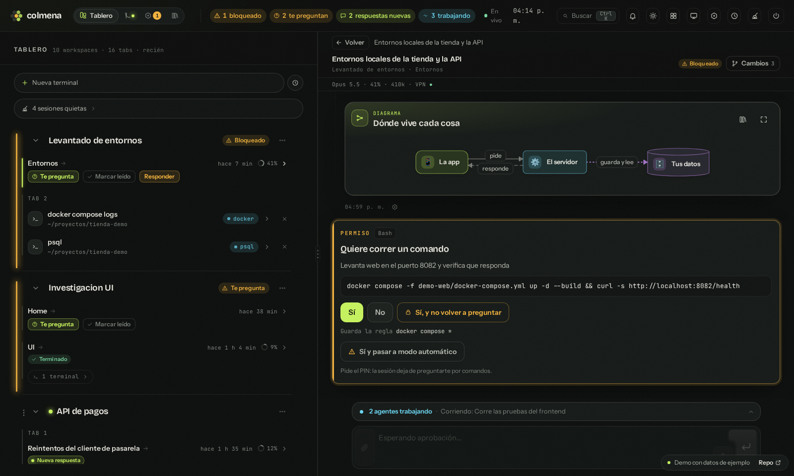
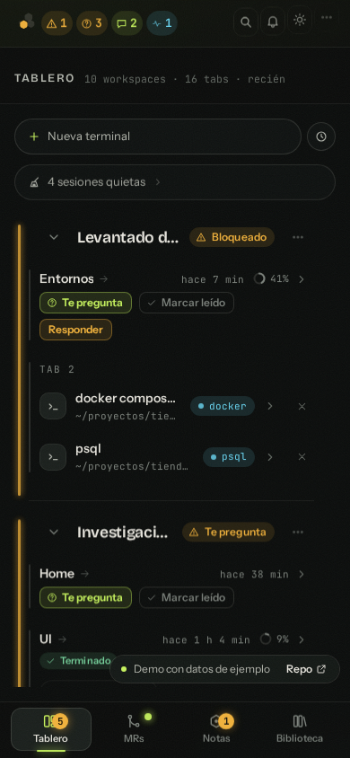

English · [Español](README.es.md)

# Colmena

An ADE (Agentic Development Environment) for running many Claude Code sessions from your phone or desktop — self-hosted, on your own Linux machine.

**Live demo (sample data): https://andonigallego.github.io/colmena/**





> **Note:** The interface is in Spanish (Rioplatense). An English UI is not available yet.

## Why

When you run several Claude Code sessions at once, each one eventually stops to ask a question or request a permission. If you are away from your computer, everything stalls until you get back to a terminal.

Colmena puts all your sessions in one dashboard that works on desktop and phone. You see the state of each one, answer questions, approve or reject permissions and give new work to agents without opening a terminal. Nothing is exposed to the internet: you reach it through Tailscale and a PIN.

## Features

### Agents

- **Claude Code sessions:** launch, resume and follow them from the dashboard, each with its state and the percentage of context used.
- **Cursor workers:** a session can delegate a mechanical change to `cursor-agent`, in a separate copy of the repo. You approve every request and there are limits (2 at a time, 6 per hour, 45 minutes each).
- **Scheduled tasks:** requests that run on their own at a set time, in a repo, with Claude or Cursor. Everything is off until you turn it on.
- **Handoffs and requests between sessions:** pass context from one session to another; a session can also ask to open another tab or close a terminal, and you approve with one tap.

### Giving them work

- **New task from a ticket:** give a Jira key (for example `ABC-123`) and Colmena creates a worktree of the repo on its own branch and opens a session asking it to start that ticket.
- **Comment on the diff:** mark lines in a session's changes, write what to fix and send them to that session in a single message.
- **MRs to the session:** send a failed job or a comment thread from a GitLab MR to an open session.

### Supervise and approve

- **Session dashboard:** all live sessions. Arrange cards and tabs as you like; the order is saved and looks the same on desktop and phone.
- **Questions and permissions:** answer questions and approve or reject permissions without opening the terminal.
- **Notifications and notch:** alerts on your phone, in the bell (which keeps a history) and in the Windows app's notch when a session asks something, waits for approval or finishes.
- **Claude plan usage:** the bar shows how much of the 5-hour and 7-day limits you have used.
- **Live terminals:** see the terminals of each tab, close the ones you no longer use and, if you enable it, type into them with confirmation.

### Context and memory

- **Library:** what sessions generate (HTML pages, files, diagrams) in one place.
- **Memory:** a local index of your sessions from the last 30 days, searchable from Settings > Memory (plus Engram, if you have it).
- **Resume old sessions:** the clock button finds a session from the last 30 days and reopens it in the card you choose or a new one.
- **Cleanup of old sessions:** proposes closing idle ones; it never closes anything without your confirmation.

### Tools

- **Voice dictation:** speak and the text lands in the chat, transcribed on your own machine.
- **GitLab MRs (optional):** your GitLab merge requests, only if you configure it.
- **Claude kit (optional):** rules, skills and hooks for the sessions, with a Kit view that shows whether it is up to date and fixes it with a button.
- **Windows app (optional):** a notch at the top of the screen showing session status, where you answer notifications and questions, plus an Environments window to open the notebook's Docker stores through an SSH tunnel.
- **Export to share:** builds a clean copy of the project, without your data.

## Requirements

- Linux with **user systemd** (the installer sets up services with `systemctl --user`).
- **Python 3.10 or newer** and **[uv](https://docs.astral.sh/uv/)** in the `PATH`.
- **Node 20 or newer** and **npm** (the frontend is Vue 3 with Vite).
- **[Claude Code](https://docs.anthropic.com/en/docs/claude-code)** (`claude` in the `PATH`), on the same machine.
- To reach it from your phone or another computer: [Tailscale](#access-from-your-phone-tailscale).

If something is missing, `./instalar.sh` tells you what to install.

## Install in 3 steps

1. From the Colmena folder:

   ```bash
   ./instalar.sh
   ```

   It asks for your name, a PIN (8 characters or more), which folders you work in and whether you will use it from your phone. It builds the app, saves the configuration in `data/config.toml`, installs the Claude notifications (if you say yes) and starts the `colmena-guardian` and `orquestador` services.

2. So the services keep running after you log out (once per user):

   ```bash
   loginctl enable-linger "$USER"
   ```

3. Open in your browser the address the installer shows at the end.

Options:

- `./instalar.sh --ensayo` shows what it would do, without touching anything.
- `./instalar.sh --sin-servicios` leaves the units in `data/units/` and explains how to enable them by hand.
- The installer asks whether to install the andokit (the Claude rules, skills and hooks the author uses, in `kit/`); Enter skips it. `--con-kit` or `--sin-kit` decide without asking.
- You can run it again to update: Enter keeps what was already set (the PIN is not touched unless you ask to change it).

To reach it from your phone, continue with the next section: the installer prints the `tailscale serve` commands but does not run them.

## Access from your phone (Tailscale)

Colmena always listens on `127.0.0.1` and never opens a port to the network. [Tailscale](https://tailscale.com) is a private network between your devices: only they can reach it. Colmena never runs `tailscale` on its own; you run the commands.

1. **Install Tailscale** on the machine running Colmena and on your phone (or other computer), with the **same account**. On Linux: `curl -fsSL https://tailscale.com/install.sh | sh` and then `sudo tailscale up`. On the phone, the Tailscale app from the store.
2. **Enable HTTPS on your tailnet** (once, before `tailscale serve`): in the [admin panel](https://login.tailscale.com/admin/dns), DNS section, turn on *MagicDNS* and *Enable HTTPS certificates*. Without that there are no `https://<your-machine>.<your-net>.ts.net` addresses, and they are needed for the secure cookie, the installable app and notifications.
3. **Publish Colmena inside your network** (only your devices see it):

   ```bash
   tailscale serve --bg --https=8444 http://127.0.0.1:8770
   tailscale serve --bg --https=8445 http://127.0.0.1:8771   # Library viewer
   tailscale serve status                                     # shows the two https addresses
   ```

4. **Configure Colmena:**
   - In `~/.config/orquestador/orquestador.env` set `ORQ_APP_ORIGIN` and `ORQ_VIEWER_ORIGIN` to the addresses shown by `tailscale serve status` (ports 8444 and 8445).
   - In `data/config.toml` set `tailscale_user` to your Tailscale login (the email you signed in with): this way only you get in, even if there are more people on the network.
   - `[entrada]` can be left unset (the default is `["tailscale"]`) or `modos = ["tailscale", "solo-local"]` if you want both.
5. **Restart Colmena** (`systemctl --user restart orquestador`) and open `https://<your-machine>.<your-net>.ts.net:8444` on your phone. Install it as an app (iPhone: Share, "Add to Home Screen"; Android: menu, "Install app") and accept notifications if you want them.

Important:

- **Never use `tailscale funnel`**: that does publish Colmena to the internet.
- **Set `tailscale_user`.** With it, the server requires the `Tailscale-User-Login` header and only that account gets in. If you leave it empty, the check is not applied.
- **Leave `cabecera_ip` empty until you verify** which header `tailscale serve` sends with the client's real IP (for example by looking at what arrives in a test request). If you set a wrong header, a client can spoof its IP.
- **PIN lockout.** While `cabecera_ip` is not set, all requests appear to come from the machine itself: failed PIN attempts are counted together, and several errors from one device lock out everyone for a while. Once you verify the header, set it to get per-device lockout.
- A direct `curl` to `127.0.0.1:8770` returns 403 on purpose: it lacks the identity header that only `tailscale serve` adds. To use Colmena on the same machine without Tailscale, use the `solo-local` mode (see the reference).
- If you change the machine name or the Tailscale network name, the addresses change: update `ORQ_APP_ORIGIN` and `ORQ_VIEWER_ORIGIN` and log in to the app again.
- Always enter through the `ORQ_APP_ORIGIN` address: the session cookie and the Library viewer only work with that origin.

From Windows you can do the same with Edge or Chrome (install it as an app), or use the Windows app from the next section.

## Windows app (optional)

`windows/colmena-app/` contains a Windows app built with Tauri. You do not need it to use Colmena: it is an extra.

- **Notch:** a pill at the top center of the screen. Each cell of the honeycomb is a session, colored by its state. Click to expand: you see the sessions, answer questions (with options or free text), approve permissions and the tab request with Open or No. Notifications come out of the notch instead of the browser notification.
- **Environments:** a window that lists the Docker environments running on the notebook and opens them with a button. The app builds an SSH tunnel with their ports and opens the page in the PC's browser. It only works from the Windows app; in the browser the view is read-only.
- It is controlled from the tray (show or hide, open Colmena, Environments, notch monitor, notebook address, start with Windows).

The first time it asks for Colmena's HTTPS address (the one in `ORQ_APP_ORIGIN`). How to build the installer, step by step: [`windows/colmena-app/COMPILAR.md`](windows/colmena-app/COMPILAR.md) (in Spanish).

## Reference

The detailed reference (manual install, entry modes, guardian and Herdr, Library, voice dictation, terminals, scheduled tasks, Cursor workers, memory and more) is written in Spanish and lives in [README.es.md](README.es.md). Topics:

- [Manual install](README.es.md#instalación-a-mano)
- [Entry and modes](README.es.md#entrada-y-modos)
- [Guardian and Herdr](README.es.md#guardián-y-herdr)
- [Library](README.es.md#biblioteca)
- [Live dashboard (SSE)](README.es.md#tablero-en-vivo-sse)
- [Voice (local dictation)](README.es.md#voz-dictado-local)
- [Terminals](README.es.md#terminales)
- [Reordering the dashboard](README.es.md#ordenar-el-tablero)
- [Resuming old sessions](README.es.md#retomar-sesiones-viejas)
- [Per-session context](README.es.md#contexto-de-cada-sesión)
- [Session cleanup](README.es.md#limpieza-de-sesiones)
- [Memory](README.es.md#memoria)
- [Notification history](README.es.md#historial-de-avisos)
- [Scheduled tasks](README.es.md#tareas-programadas)
- [Sharing Colmena](README.es.md#compartir-colmena)
- [Cursor worker](README.es.md#trabajador-cursor)
- [New task and tickets](README.es.md#nueva-tarea-y-tickets)
- [Diff comments](README.es.md#comentarios-del-diff)
- [MRs to the session](README.es.md#mrs-a-la-sesión)
- [Claude plan usage](README.es.md#uso-del-plan-de-claude)

## Development

```bash
uv run pytest                                   # backend
cd frontend && npx vitest run                   # frontend
cd frontend && npm run dev                      # http://127.0.0.1:5173 (proxy /api to :8770)
# http://127.0.0.1:5173/?mock=1 -> fake data, no backend
```

## Contributing

Issues and pull requests are welcome. Please run the backend and frontend tests above before sending a change.

## License

[MIT](LICENSE) © 2026 Andoni Gallego
